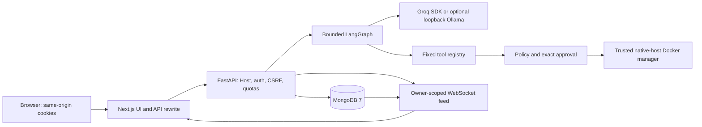
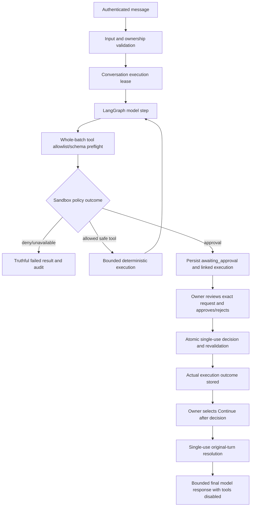

# AgentShield AI architecture

AgentShield combines a Next.js/TypeScript/Tailwind frontend, a single-process FastAPI/Python 3.12 API, PyMongo Async with MongoDB 7, bounded LangGraph workflows, optional Groq/Ollama providers, a fail-closed Docker adapter, and signed real-time monitoring. Authentication and authorization are enforced in the API, not by frontend navigation.

## Account and request boundaries

Registration normalizes email and stores only Argon2id hashes. Login issues an issuer/audience/purpose/expiry-validated JWT in a host-only HttpOnly/SameSite cookie and stores a revocable server-side session. Production mode requires HTTPS origins and Secure `__Host-` cookies. Authenticated responses include a safe expiry timestamp, never the access token. There are no refresh tokens or localStorage tokens.

State-changing routes require an exact Origin and a signed, session-bound double-submit CSRF token. Valid CSRF credentials are reused within their expiry to avoid multi-tab rotation races; login clears anonymous CSRF state. Host admission rejects unconfigured authorities for HTTP and WebSockets. Rate counters, admission limits, request byte/depth/chunk/time bounds, and bounded password work apply independently of model text.

The frontend's shared protected-request helper treats401 as an invalidated session and distinguishes503/network outages from logout. Session expiry schedules a bounded recheck; explicit logout and confirmed auth failure cancel monitoring retries. Protected server layouts verify the cookie with the backend before rendering private content.

## Agent lifecycle

Groq is the primary optional provider; no key is required for account/dashboard/monitoring startup. Missing keys and provider errors fail clearly rather than fabricating answers. Ollama remains opt-in and loopback-only in native-host mode. Neither provider is selected or downloaded automatically. Provider reads, request duration, model iterations, tool count, code/input/output sizes, and conversation context are bounded.

Tool names and schemas are fixed server code. The existing session-creation API stores the chosen provider, server-enabled model, and allowed tools. User configuration can reduce the allowlist; it cannot add capabilities or change policies. Calculator uses an AST whitelist, summarization is bounded extractive text processing, JSON formatting is strict, and Python execution enters only through the sandbox service. No unrestricted host shell/file/network tool exists.

A pending approval is an actual paused application turn, not a successful tool response. The server binds the execution to that turn, user, and conversation. The decision is expiring, content/policy-bound and single-use. Resolution consumes the stored outcome once; it never submits Python again. It is an explicit frontend action so another provider request is visible to the user. Finalization has no tools and respects the retained iteration budget. Further tool work requires a new user turn. This avoids a background/checkpointer service and indefinite HTTP waits. See the API documentation for exact paths and response fields.

## Persistence and bounded reads

| Collection | Purpose |
| --- | --- |
| `users` | Normalized unique email, public profile, Argon2id hash |
| `sessions` | Owner-bound revocable JWT session IDs and expiry TTL |
| `agent_sessions` | Provider/model/allowlist, turn count, status and fenced execution lease |
| `agent_messages` | Owned turns, redacted messages/events, duration, waiting/resolution metadata |
| `agent_configs` | Existing atomic per-owner conversation quota |
| `execution_logs` | Bounded execution outcomes, limits, approval metadata and internal turn linkage |
| `sandbox_approvals` | Exact pending request, fingerprint, owner, expiry and single-use state |
| `sandbox_locks` | Distributed one-live-sandbox admission and fail-closed recovery state |
| `monitor_streams` | Last200 per-user signed replay events and monotonic sequence/cutover |
| `monitor_connections` | At most 20 shared WebSocket leases, four per user |
| `security_events` | Expiring rate counters and seven-day signed metadata audit rows |

Indexes cover unique email, session/approval/log expiry, owner/time histories, active leases, unique owner/session/turn, and audit sequence queries. Reads paginate rather than load entire histories. Conversation context retains the most recent six completed turns, clipped per existing limits. UI lists and replay/dedup buffers are bounded. MongoDB's small connection pool starts empty and closes on graceful shutdown.

Standalone MongoDB has no cross-document transactions. An interruption can leave conservative quota counts, incomplete turns, a consumed approval without a final result, or a signed feed append without its audit-row insertion. Fenced leases prevent an old finalizer from releasing a newer execution. Failures do not restore consumed approvals, grant another owner access, or bypass readiness. See security/testing docs for fault-recovery evidence and residual risks.

## Live monitoring

The API polls an authenticated owner's bounded MongoDB feed only while that socket is open. Signed events contain fixed metadata, not messages, code, credentials, tool arguments/results, system prompts, or private reasoning. Each delivery rechecks session revocation and the shared connection lease. The browser deduplicates ordered sequences, replies to heartbeats, refreshes REST state on reconnect, and uses bounded exponential backoff for transport failures. Auth failure/logout/known origin mismatch stops retries. Replay gaps trigger snapshot resynchronization; the API does not promise exactly-once delivery or indefinite retention.

## Deployment boundary

The Compose stack runs non-root app containers plus authenticated MongoDB 7 on private networks. Only the frontend is bound to loopback. The public-facing backend has **no Docker socket** and forces sandbox execution off. No remote orchestration API is introduced. A complete sandbox demonstration uses the native trusted-host backend with a separately validated Colima runtime and the same frontend/API/database contracts. Compose and native modes are different deployment choices, not weaker isolation fallbacks.

See [deployment.md](deployment.md), [security.md](security.md), and [testing.md](testing.md) for setup, enforcement details, validation, backup/recovery, and limitations. Historical phase documents describe their original snapshots; this document and Phase 7 docs describe the final integrated application.
