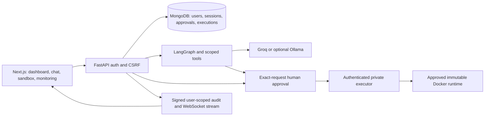

# Phase 10 — release readiness, 2026-11-07

## Scope and disposition

Base: `afdc376` (main, including merged caret fix). Work branch:
`phase10/release-readiness`. This phase reran integration/security checks and
prepared release evidence; it did not change application behavior, configuration,
dependencies, credentials, or data. No new critical regression was identified in
the checks performed. This is **not production certification**. Live acceptance
remains required; no release tag or automatic merge is authorized.

## Architecture and implemented features



Password/Google identities share JWT HttpOnly sessions. Explicit account linking
prevents automatic email-based merging. Agent tools include calculator, extractive
summarization, JSON formatting, legacy Python sandbox and six-language execute_code.
The UI retains saved conversations, pending decisions, real execution history,
compiler/runtime output, loading/error states, responsive navigation and aligned
syntax-highlighted code editing.

## Security review and evidence map

- Groq uses a fixed official origin, selected model, bounded responses, timeouts,
  no redirects or silent provider fallback. Tool arguments and allowed tools are
  validated server-side. `test_agents`, `test_groq_request_path`, and `test_phase6`
  exercise serialization, errors, injection, scoped dispatch and secret redaction.
- `test_sandbox_auto` verifies mandatory agent approval in approval, auto and
  legacy allow modes. AUTO requires explicit trusted-local development settings
  and loopback origins. The legacy direct-user allow policy remains supported;
  deployment operators should use approval or guarded auto, not treat legacy allow
  as trusted-local AUTO. No policy was loosened in this phase.
- `test_sandbox`, `test_multilanguage_api`, `test_phase7_workflow` cover ownership,
  acceptance/rejection, expiry, replay, atomic claims, code/language/stdin/runtime/
  resource fingerprint binding and restart persistence. Continuation reads the
  stored result without rerunning code. Runtime I/O is mocked in these checks.
- `test_executor` exercises signed request authentication, replay protection,
  configuration matching and restart epochs. It does not prove real daemon crash
  recovery. Recovery involving a live Docker execution remains a Mac test.
- `test_auth`, `test_google_oauth`, `test_phase6` cover registration, login/logout,
  cookies, expiration, CSRF, rate limiting, protected APIs and safe identity linking.
  Google network responses are mocked; no live test identity was used.
- `test_monitoring`, `test_monitor_origin`, `test_phase7_workflow` cover persisted
  signed events, user isolation, rejection/failure outcomes, reconnect and
  authentication revocation. Logs intentionally minimize source/payload data.
- Native calculator/text/JSON tools actually run in tests. Six-language HTTP,
  approval, history and runtime-contract tests use mocked container results.
  Live success, syntax/runtime failure, timeout and kernel limits for every
  language are NOT VERIFIED in this cloud environment.
- CodeEditor regression compares computed metrics and actual screenshot pixels of
  the painted caret against highlighted text, including Python/JavaScript editing
  and scrolling. Six-language UI and approval regressions also pass.

## Executed results

| Check | Status | Evidence |
|---|---|---|
| Full backend unit/integration/security suite | PASS | 409 passed, 16 skipped, 0 failed; 58.97 s |
| Real Docker pytest cases | SKIPPED | 16 opt-in cases; not counted as passed |
| pip dependency compatibility | PASS | `pip check`: no broken requirements |
| Python requirements vulnerability audit | PASS | `pip_audit -r backend/requirements.txt`: no known vulnerabilities |
| Frontend production dependency audit | PASS | npm audit --omit=dev: 0 vulnerabilities |
| Full frontend dependency audit | PASS | npm audit: 0 vulnerabilities |
| ESLint / TypeScript | PASS | Actual configured commands completed |
| Production Next.js build | PASS | Playwright production server build and Docker build |
| Browser suite | PASS | 30 passed, 0 failed; 1.3 min |
| Compose configuration | PASS | Base + executor overlay, synthetic placeholder variables |
| Backend Docker image build | PASS | application target; configured UID/GID 10001 |
| Frontend Docker image build | PASS | non-root standalone runtime |
| Frontend image HTTP health | PASS | /login returned success in a temporary network-disabled container |
| Backend application health | PASS | Actual FastAPI/MongoDB startup and /ready used by browser runner |
| Full deployed Compose/backend-image health | NOT TESTED | No application stack launched or replaced |
| Live Groq tool workflow | BLOCKED | Backend has no configured Groq credential |
| Live Google/Ollama | NOT TESTED | No safe identity/local provider configured for this run |
| Real sandbox validator | BLOCKED | exit 2, CGROUP_V2_UNAVAILABLE, tests: [] |
| Changed-file credential-pattern scan | PASS | Heuristic check, not a full secret-discovery guarantee |

Runtime readiness reports cgroup v2 with driver `none`. No untrusted program was
submitted after this failure. Frontend image health is a trusted application smoke
test, not evidence of sandbox security. Audit results are a point-in-time advisory
lookup, not a guarantee of vulnerability absence. Existing Starlette/AnyIO and
Uvicorn deprecation warnings remain; no tests were disabled to suppress them.

Reproduction commands (use an isolated credential-free test MongoDB):

```sh
PYTHONPATH=backend TEST_MONGODB_URI=mongodb://127.0.0.1:27018 \
 PYTEST_DISABLE_PLUGIN_AUTOLOAD=1 backend/.venv/bin/python -m pytest backend/tests -q --tb=short
backend/.venv/bin/python -m pip check
backend/.venv/bin/python -m pip_audit -r backend/requirements.txt
npm --prefix frontend audit
npm --prefix frontend run lint
npm --prefix frontend run typecheck
TEST_MONGODB_URI=mongodb://127.0.0.1:27018 npm --prefix frontend run test:e2e
```

Cloud browser runs selected `/usr/bin/chromium`; install Playwright Chromium on the
Mac as needed. Docker builds used the existing Dockerfiles and their optional
`proxy_ca` secret mount with the system CA bundle. No CA/credential was copied into
image layers. Builds were tagged `agentshield-phase10-backend-check` and
`agentshield-phase10-frontend-check`, without replacing application tags. Temporary
frontend health container was removed. The existing isolated test MongoDB was
started for validation and returned to its stopped state; user databases and
volumes were not reset. Compose inspection confirmed no Docker socket on backend
and no published database or executor ports.

## Release blockers and deployment requirements

1. Live Groq tool-selection and human-approval workflow on the deployed application.
2. Effective Mac/Colima resource limits, six-language execution and real executor
   startup/restart/timeout cleanup. Prior historical passes do not verify this run.
3. Full deployment health, backup/restore rehearsal and configuration review.
4. Public deployment needs HTTPS/WSS, Secure cookies, strict trusted origins/hosts,
   private MongoDB, protected executor credentials and careful proxy logging.
5. Docker daemon access makes the executor a powerful trust boundary. Ordinary
   containers do not certify resistance to kernel escapes; use dedicated worker
   VMs or stronger isolation for public adversarial workloads.

Database recovery tests exercise disposable test state and simulated failures;
this run did not terminate an application's MongoDB or conduct a physical restore.
No claim of data-loss-free disaster recovery is made. No v1.0.0 release is created.

## Exact remaining Mac acceptance steps

Use the existing checkout, Compose project and Colima profile. Do not regenerate
`.env.compose`, executor/JWT/audit keys or run `down -v`.

```sh
colima status
docker context show
docker info --format 'cgroup={{.CgroupVersion}} driver={{.CgroupDriver}}'
bash scripts/validate-phase4-colima.sh
PYTHONPATH=backend backend/.venv/bin/python backend/scripts/validate_multilanguage.py \
 --docker-url "unix://${HOME}/.colima/default/docker.sock"
```

Adjust the socket only for the intended Colima profile. Preserve configured
immutable images in backend/.env. If readiness fails, stop; never bypass checks.
Validate the existing stack configuration/health using its actual project name:

```sh
docker compose --env-file .env.compose -p agentshield-ai-v7 \
 -f compose.yaml -f compose.executor.yaml config --quiet
docker compose --env-file .env.compose -p agentshield-ai-v7 \
 -f compose.yaml -f compose.executor.yaml ps
```

For each language, run the existing deployed-path validator:

```sh
for language in python c cpp java javascript typescript; do
 backend/.venv/bin/python scripts/validate-deployed-sandbox.py \
  --base-url http://localhost:3000 --language "$language" --policy auto || break
done
```

Use `--policy approval` if that is the configured direct-user policy. The script
creates synthetic accounts and retained history/audit rows; observe quotas. A
hello-world pass alone does not validate every failure/resource boundary. Follow
the existing sandbox guides for harmless syntax, runtime, timeout, output-limit,
network and filesystem checks in all six languages.

Then test Playground with live Groq: calculator, summarize_text, format_json,
python_sandbox and execute_code. Inspect actual tool_request/tool_response and
signed events, not just a model answer. Code must remain pending until its owner
reviews exact language/source/stdin and explicitly approves. Test rejection,
expiry, duplicate decisions, a second user's denial, and restart while pending.
Verify reload preserves the result and the painted caret remains aligned. Test
Google login/linking only with an explicitly configured safe test identity.

Finally rehearse backup/restore on a disposable database and record commit, runtime
versions, timestamps and results without tokens, cookies or private source. The
recommended next step is operator-assisted live acceptance and a demo recording,
not further feature expansion or an unsupported production certification.
