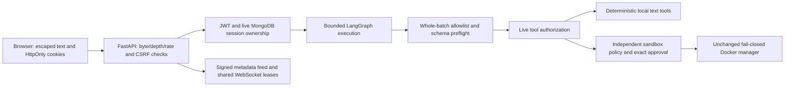

# Phase 6 — advanced security hardening

This phase strengthens the existing application boundaries. It preserves account authentication, agents, sandbox approvals, monitoring, and the dashboard. It does not implement Phase 7 or certify the application for hostile multi-tenant production use.

## Threat model and audit findings

Assume users, user messages, future retrieved text, provider responses, tool names/arguments, browser frames, and HTTP bodies are untrusted. A valid login grants access only to that user's resources; it does not authorize arbitrary tools or container controls. Model text cannot change permissions, limits, or approvals. Server configuration, the installed application, and its secret store are operator-controlled. A fully compromised host, signing key, Docker daemon, or database administrator remains outside the guarantees of these application controls.

| Finding in Phases 1–5 | Enforcement added | Main source |
| --- | --- | --- |
| A later invalid tool in a model batch was detected only after earlier tools could run | Preflight every proposed tool against the server allowlist and exact input schema before any dispatch | `agents/engine.py`, `agents/tools.py` |
| Authorization was checked at request start, leaving revocation/tool-permission changes during provider waits unchecked | Recheck the live session and current conversation allowlist immediately before each tool; recheck authorization before sandbox manager execution | `agents/api.py`, `sandbox/api.py`, `sandbox/service.py` |
| Provider JSON was buffered before size/schema checks; SDK endpoint environment overrides were accepted | Official Groq SDK streaming-response APIs; 100,000-byte read limit, no redirects, fixed HTTPS Groq endpoint; literal loopback Ollama endpoint, no environment proxy, no redirects | `agents/providers.py` |
| Duplicate JSON fields/non-finite numbers/deeply nested structures had ambiguous or excessive parsing behavior | Duplicate-field rejection, finite JSON numbers, depth 32; bounded tool argument serialization and per-tool schemas | `guards.py`, `agents/tools.py`, `main.py` |
| Body buffering had no read deadline/chunk-count bound; authentication work could queue indefinitely | 10-second body deadline, at most 1,024 chunks, existing byte caps; two hash workers with eight total admitted hash/verify operations | `main.py`, `security.py` |
| WebSocket admission was process-local and revocation was checked only per replay batch | Shared atomic MongoDB leases, authorization and lease revalidation before every event, duplicate-Origin/query rejection | `monitoring/connections.py`, `monitoring/api.py` |
| Approval execution used the earlier read of the pending request | Revalidate the exact atomically claimed document, fingerprint and ownership, then live authorization before execution | `sandbox/service.py` |
| Redaction missed quoted JSON credentials, bare JWTs, database/audit credentials and old stored responses | Central redaction on writes and historical response reads; reject credential-bearing approval code, including legacy pending requests | `guards.py`, `agents/api.py`, `sandbox/service.py` |
| Stored monitoring records had no cryptographic modification detection | HMAC-SHA256 signatures include the full event and sequence; verify before replay/audit response/append; explicitly label historical unsigned records | `monitoring/events.py`, `monitoring/api.py` |

The review also checked auth/CSRF/JWT ownership, Mongo query construction/indexes, LangGraph/tool limits, sandbox container configuration/lifecycle, frontend rendering/proxy/cookies, dependency manifests, CI, existing tests, and validation scripts. Existing controls that already enforced the intended boundary were retained.

## Security architecture



A system instruction is guidance, not a security boundary. Tests deliberately supply instructions to ignore policy and model-generated unauthorized calls. The enforced result is denial with no tool side effects. This does **not** prove that an LLM will never follow a prompt injection, reveal a paraphrased instruction, or produce harmful/incorrect prose. No retrieval integration or unrestricted network/shell tool is added.

### Agent and provider boundaries

Only `calculator`, `summarize_text`, `format_json`, and `python_sandbox` are recognized, and the conversation's server-stored allowlist may narrow them. Text inputs remain at most 4,000 characters; arithmetic/JSON tools retain their additional complexity/output limits. The Python model-facing schema accepts **only** `code`, at most 32 KiB UTF-8. Models cannot submit agent/user IDs, Docker images, flags, mounts, environments, approval booleans, or resource settings. Serialized model arguments are capped at 40,000 bytes. The API binds the authenticated conversation ID itself.

All calls in a model batch must validate before the first dispatch. Existing iteration, tool count, time, context, session, and turn limits remain. The live authorization callback rechecks session expiry/revocation and the current owned conversation's allowlist. An auth/database/audit failure prevents the next tool dispatch. An already-completed side effect cannot be undone by a later logout; this is not a multi-document authorization transaction.

Groq uses the official SDK at `https://api.groq.com`; `GROQ_BASE_URL` cannot redirect credentials. Both providers disable redirects and request identity encoding. Unexpected compressed responses are rejected before reading/decompression, and response bytes are bounded while streaming, before JSON/schema parsing. Oversized metadata is bounded too. Ollama remains opt-in and restricted to configured loopback origins; `localhost` is normalized to `127.0.0.1` rather than resolved through DNS. No URL/model destination comes from a tool argument. Groq keeps the managed environment's normal proxy/TLS trust; Ollama does not use environment proxies. No retries, automatic provider changes, purchases, or downloads are introduced.

### Authentication, request admission, and rate limits

The existing Argon2id settings, short-lived issuer/audience-validated JWTs, HttpOnly/SameSite cookies, production Secure cookies, live session ownership, and signed session-bound CSRF remain. CSRF and WebSockets require exactly one Origin header matching a configured origin. Oversized JWTs are rejected before decoding.

The existing per-IP/per-email registration/login limits, per-user agent write limits, sandbox quotas, monitor read/handshake limits, and request body byte caps remain. Agent metadata/history/list reads now share 120 requests per authenticated user per existing rate window (300 seconds by default). Authentication admits at most eight hash/verify operations per process, with only two CPU/memory workers active; excess requests get 429 rather than an unbounded wait queue. Bodies retain the existing 16 KiB normal / 256 KiB sandbox JSON byte caps, and now have a ten-second read deadline and a 1,024-chunk ceiling. Empty/slow fragments cannot accumulate without bound. Invalid input errors do not echo submitted values.

These are application controls, not DDoS protection. Login IP limits still see the reverse proxy peer unless a deployment configures trusted forwarding properly. Keep the documented default of disabled proxy headers for local use. A public deployment needs TLS, edge request/connection limits, body/header limits, protected MongoDB credentials/networking, and an appropriate process budget. Agent/hash capacity is still per process; one backend process is recommended for an 8 GB Mac.

### WebSocket security

The existing cookie/session/Origin checks, heartbeat/pong, replay ordering, bounded batches/feed, slow-send timeout, and disconnect cleanup remain. New `monitor_connections` stores one bounded pool of at most 20 connection leases, with at most four per user **across backend workers sharing this database**. Admission is a single conditional MongoDB update. Leases last 60 seconds, renew during polling and before each event, and release on disconnect. Expired leases are pruned by subsequent admission; there is no extra worker. A crash or uncertain cleanup conservatively holds capacity until expiry. Failure to acquire/renew closes delivery; no in-memory-only fallback exists.

JWT/session revocation is rechecked before **each** replay event so a slow batch cannot continue after revocation was observed. In-flight frames cannot be recalled. Query parameters accept only a single nonnegative ASCII `after` cursor; tokens/ambiguous cursors are rejected. Binary control frames and invalid/excessive pong input close the connection. Existing monitor handshake/read quotas remain shared through MongoDB. Transport frame/queue bounds require the launcher flags below; ASGI validation occurs after a frame is received.

### Approval and sandbox boundaries

Both decisions retain authenticated ownership, CSRF, quotas, exact request hash, pending state, expiry, and atomic single-use consumption. After approval wins the race, the exact consumed document is revalidated against the code/policy fingerprint and current ownership; mutation or policy changes cannot substitute another request. Authorization is rechecked just before the sandbox manager call. A rejection never calls the manager. A consumed request is not restored after failure, so retries cannot replay it; submit a new request when needed.

Credential-bearing legacy pending code is blocked on review and approval rather than silently altered. Code review still shows the exact permitted request. Redaction patterns can conservatively reject benign text resembling credential assignments; do not put credentials into code. Manual sandbox API requests remain independent of an agent's model tool allowlist, but still require the authenticated owner's sandbox policy and approval. An agent dispatch must satisfy both its own allowlist and the sandbox policy.

The Docker manager and deterministic policy files are unchanged. Reviewed digest, UID 65534, no privileges/capabilities/escalation, no network, read-only root, private namespaces, no host mounts/socket/secrets, effective cgroup limits, PID/time/output/code bounds, writable bounded tmpfs, cleanup, and one-live-execution lease remain required. Readiness still rejects an unsuitable daemon with `SANDBOX_UNAVAILABLE`. There is no host fallback. Container isolation is not a complete defense against malicious code or kernel/runtime vulnerabilities; gVisor/Firecracker integration is not implemented here.

### Audit integrity, privacy, and migration

New events carry an HMAC-SHA256 signature over canonical event metadata, timestamp at BSON millisecond precision, owner, identifiers, action/status, and sequence. Compare-and-swap appends allocate and sign that sequence atomically within the bounded feed; concurrent writers retry at most 32 times and otherwise fail closed. Signatures are checked before delivering signed events over REST/WebSockets and before extending a signed feed. Invalid signed records return a safe 503 / close the socket. Signatures and signing keys are not sent to the browser or LLM. Metadata remains a fixed vocabulary, never prompts, code, tool payloads, hidden reasoning, or credential strings.

`AUDIT_SIGNING_KEY` is optional, validated with the same minimum strength as `JWT_SECRET`. Set a separate stable random value **before the first Phase 6 start** if audit verification must survive JWT rotation. If unset, a domain-separated audit key is derived from `JWT_SECRET`. Changing the effective audit key invalidates existing signatures and intentionally fails closed. There is no keyring/automatic rotation or external witness. To separate a previously derived key before rotating JWT, a trusted operator can securely preserve the *previous* JWT secret as `AUDIT_SIGNING_KEY`; do not print or paste either key into chat. Back up keys/data and follow a deliberate rotation plan. Do not delete audit records to hide a verification failure.

Phase 5 history is preserved and labeled `legacy_unverified`, including a visible unsigned label in the timeline. The first signed sequence is recorded in `monitor_streams.signed_from`; removing a new event's signature is not accepted as ordinary legacy data. This is **modification detection**, not a tamper-proof ledger: an administrator controlling the database can delete/roll back entire valid histories or alter legacy/cutover metadata. Compromise of the application/signing key defeats the signatures. No append-only external archive, attested ordering across deleted records, or forensic nonrepudiation is claimed. Analytics aggregates still trust their underlying stored execution records.

The feed update and audit insert remain separate standalone-MongoDB writes. Audit insertion failure stops a subsequent tool action, but an interruption may leave a signed feed event without its audit row. Terminal audit failure cannot undo an execution that already completed. Retention remains seven days for audit rows and the last 200 events per user for replay. The pool document is bounded to 20 lease slots; no new paid/broker service is required.

Redaction covers configured JWT/Groq/audit keys, MongoDB URI/password, common quoted JSON credential assignments, bare JWTs, bearer values, recognized API tokens, and private-key blocks. It applies to model results/errors, conversation/history responses, and sandbox output reads as well as new persistence. It is best effort: arbitrary encodings, paraphrases, split values, operator debug/proxy logs, and secrets unknown to the app are not a DLP guarantee. Do not submit confidential content. JWT/CSRF cookies and the signed CSRF response remain intentional authentication credentials, not application log payloads.

The frontend keeps text rendering through React and adds CSP restrictions for objects, base URLs, framing, and form destinations plus disabled camera/microphone/geolocation permissions. This deliberately is not a complete nonce-based `script-src` CSP. Browser tests verify stored hostile **user and model** markup remains text after reload. No UI redesign is introduced.

## Local setup and validation

Preserve the populated `.env`, account data, signing keys, existing Colima setup, and Phase 4 limits. The only new optional server setting is `AUDIT_SIGNING_KEY` in `.env.example`; do not overwrite existing keys. Start MongoDB using the README, then from the repository root:

```sh
backend/.venv/bin/python -m pip install -r backend/requirements-dev.txt
bash scripts/run-backend.sh
```

The new launcher binds loopback and explicitly sets WebSocket frames to 1,024 bytes, incoming queue to eight, HTTP concurrency to 64, keep-alive to five seconds, and disables proxy-header trust. It starts one backend process and does not enable the sandbox or download models/images. A custom deployment must retain equivalent bounds. The currently tested Uvicorn legacy WebSocket transport emits a deprecation warning; a future transport migration must separately verify queue/backpressure semantics.

Start the frontend in another terminal with `cd frontend && npm ci && npm run dev`. Sign in, use the Playground and monitoring page, and approve/reject a sandbox request only on an already verified runtime. Existing local browser origin/CORS and production HTTPS requirements remain.

```sh
cd backend
.venv/bin/python -m pip check
.venv/bin/python -m pytest -q
.venv/bin/python -m pytest -q tests/test_phase6.py
.venv/bin/python -m pip_audit -r requirements-dev.txt
```

```sh
cd frontend
npm run lint
npm run typecheck
npm run build
npx playwright install chromium
npm run test:e2e
npm audit --audit-level=moderate
```

Tests require a credential-free loopback MongoDB and disposable test databases. Browser tests use a production Next.js build, real WebSockets, and real MongoDB with explicitly mocked model and Docker adapters. They do not prove live provider inference or container isolation. The test-only provider remains unavailable through the normal application entry point. See README for system Chromium/Python overrides and pip-audit installation.

### Recorded validation

- Backend: **183 passed, 10 skipped**. This includes **45 new adversarial Phase 6 cases** plus existing Phases 1–5 tests. One upstream Starlette/AnyIO deprecation warning remains.
- Frontend: ESLint and TypeScript passed; production build and **10 browser tests passed**, including extra header and stored user/model markup assertions.
- Backend and frontend dependency audits: no known vulnerabilities reported; `pip check` passed.
- Hardened launcher: shell syntax and live health/readiness/protected-route checks against a disposable MongoDB were exercised; no model/container execution was requested.
- Real managed-daemon readiness: **`SANDBOX_UNAVAILABLE`**, CLI exit 2; the runtime reports cgroup driver `none`. **No untrusted Docker test programs were executed.** The ten opt-in real-Docker pytest checks are skipped, not passed. The user-reported 12/12 ARM64 Colima Phase 4 result is a separate earlier local result.
- Real Groq/Ollama inference was not attempted; provider tests use mocked HTTP transports.

To validate real isolation on your Mac, run the unchanged procedure separately:

```sh
bash scripts/validate-phase4-colima.sh
```

Do not run sandbox programs if that readiness gate fails. No managed daemon security settings are changed by this phase.


## Files changed

- Shared input/privacy/auth boundaries: `backend/app/guards.py`, `security.py`, `config.py`, `main.py`, `database.py`, and `.env.example`.
- Agent enforcement/I/O: `backend/app/agents/api.py`, `engine.py`, `providers.py`, `tools.py`.
- Monitoring: `backend/app/monitoring/api.py`, `events.py`, and new `connections.py`.
- Sandbox service/API: `backend/app/sandbox/api.py`, `service.py`. The manager, readiness probe, policy, image digest, and real-Docker validation scripts are unchanged.
- Browser protections/legacy labeling: `frontend/next.config.ts`, `frontend/src/components/monitoring.tsx`.
- Tests and explicit browser fixtures: new `backend/tests/test_phase6.py`; existing backend `conftest.py`, `test_agents.py`, `test_auth.py`, `test_monitoring.py`; `backend/scripts/browser_test_app.py`; frontend `tests/auth.spec.ts`, `tests/playground.spec.ts`.
- Local launcher/documentation: new `scripts/run-backend.sh`, new `docs/phase6.md`, and updates to `README.md`, `docs/phase5.md`.
