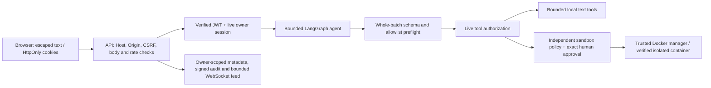

# Security model and operating boundaries

AgentShield AI treats user text, model responses, future retrieved text, tool arguments, HTTP bodies and WebSocket frames as untrusted data. The backend is the authorization boundary. UI controls and model instructions explain behavior; they do not grant permission. This document describes the enforced application controls and the deployment work they do not replace.

## Trust boundaries

The browser never receives an API key, signing key, plaintext password, password hash, or JWT in JSON. JWT/CSRF cookies and the signed CSRF response are intentional authentication credentials. Do not paste credentials into prompts, code, issue reports, screenshots or logs.

## Authentication and authorization

- Passwords use Argon2id with independent salts, 19 MiB memory, two iterations and parallelism one. Two active hash workers and eight admitted hash/verify operations bound the per-process queue.
- Short-lived HS256 access JWTs require issuer, audience, subject, session ID, issue/not-before/expiry timestamps and an access purpose. An expired/deleted server session or missing user is rejected even when the signature is valid. Logout revokes the current session.
- Cookies are host-only, HttpOnly and SameSite Lax. `APP_ENV=production` requires HTTPS origins and sets Secure `__Host-` cookies. No auth tokens are stored in localStorage.
- Mutations require exactly one allowed Origin plus a signed, matching, session-bound CSRF cookie/header. Valid CSRF tokens may be reused until expiry within the same session to avoid cross-tab rotation races; login changes the session binding. A cold-cookie race may recover once after the exact pre-handler CSRF rejection by fetching a fresh token; timeouts and other authorization failures are not automatically retried. This does not remove the double-submit, signature, audience, purpose, expiry or Origin checks.
- Safe authenticated responses may include `session_expires_at` to schedule UI expiration handling; it is not an access token.
- Every conversation, message, approval, sandbox execution, audit history and monitoring feed is scoped to the verified owner. Client/model input cannot select another owner. Exact configured trusted Hosts apply to both HTTP and WebSocket admission.

Default login/register counters are shared through atomic MongoDB updates, using HMAC-pseudonymized identifiers rather than raw emails/IPs. Agent, sandbox, read and WebSocket endpoints have separate bounded quotas. These controls do not replace edge DDoS limits or correct trusted-proxy configuration. The documented local launchers disable proxy-header trust.

## Tool execution and human approval

Recognized tools are `calculator`, `summarize_text`, `format_json`, and `python_sandbox`. A session's allowlist can restrict them; model output cannot add capabilities. Each entire proposed call batch is validated before the first tool dispatch. Text tools cannot read files, access the network or run shell/Python code on the host. Arithmetic uses an AST whitelist rather than Python evaluation.

The Python model-facing schema accepts only bounded `code`. It cannot accept Docker images, mounts, environment variables, resource limits, owner/session IDs, approval flags or arbitrary shell commands as control parameters. The API binds the conversation and turn internally. Tool permissions and session authorization are checked again before execution.

A pending Python request pauses the agent in an explicit waiting state. The human reviews the exact stored code, resource limits and request fingerprint in the sandbox/monitoring UI. Approve/reject operations atomically consume the matching owner/hash/pending/unexpired request. Approval revalidates the exact claimed content and policy before the sandbox manager runs. Duplicate or cross-user decisions cannot execute code. After a valid claim, the code payload is removed and a consumed marker is retained briefly while execution metadata settles. This changes marker retention only: the claim still requires the original unexpired pending request, and a used marker grants no replay permission. Rejection never invokes the manager.

The user can then resolve the original waiting turn from its stored execution outcome. Resolution is authenticated, CSRF-protected and single-use; it does not submit the code again. Final model synthesis has tools disabled and remains within the original model iteration budget. Expired, rejected or failed execution results produce truthful failed/blocked outcomes. Further tools require a new user turn rather than hidden continuation. A failure cannot restore a consumed approval or recall an already completed side effect. A host/process crash can leave an in-progress record or orphaned container requiring explicit trusted-operator inspection and cleanup; the application never replays code to repair uncertain execution history.

## Sandbox restrictions

The unchanged Docker manager requires a reviewed image digest, UID 65534, no privileged mode, no added capabilities, dropped capabilities, no-new-privileges, active seccomp filtering, private PID/IPC/cgroup namespaces, disabled network, a read-only root filesystem, and a bounded writable noexec/nosuid/nodev tmpfs. No host home, credentials, application `.env`, database data, or Docker socket is mounted into an execution container.

Defaults remain 128 MiB memory with no swap, at most one CPU, 32 PIDs, ten seconds of program runtime, 64 KiB raw combined output, 32 KiB UTF-8 code and one admitted execution across backend workers. Settings are validated. Before submitted code runs, the trusted probe verifies effective kernel resource limits and isolation; the container runner repeats those checks. Timeout, error and cancellation paths retain cleanup responsibilities. Unavailable controls return `SANDBOX_UNAVAILABLE`; there is no host or unrestricted fallback.

Docker containers do not establish immunity against malicious code, kernel flaws or container escapes. A trusted host process with Docker access has substantial host authority. The full sandbox demonstration is therefore a local, trusted-operator mode on a separately validated Colima runtime. The public-facing Compose backend has no Docker socket and forces sandbox execution disabled. A separate authenticated orchestration service, gVisor/Firecracker integration and hostile-tenant production certification are not implemented. See [deployment.md](deployment.md).

## WebSocket delivery

Handshakes require an allowed exact Origin, trusted Host and a live cookie-authenticated session. Clients cannot supply user/session subscriptions or credentials in query strings; only one bounded ASCII replay cursor is accepted. Authorization and connection lease validity are rechecked during delivery and before each replay event.

Shared MongoDB leases cap admitted connections to four per user and twenty overall across workers using the same database. They renew while connected and expire conservatively after interruption. Retained replay is bounded to 200 events/user and batches of 50. The browser deduplicates and orders bounded event state, uses capped exponential reconnect delays, and refreshes REST snapshots when replay cannot cover a gap. Confirmed auth failure or logout stops reconnecting; a network outage alone is not proof of logout.

Only heartbeat pong input is accepted, at bounded size/frequency. Send timeouts, heartbeat expiry, lease loss and safe task cleanup handle stalled clients. The launcher supplies the transport's frame/queue bounds; deployment must retain equivalent limits. No unbounded background event broker is added.

## Audit integrity and privacy

New monitoring records are HMAC-SHA256 signed over fixed metadata, owner, timestamp at BSON millisecond precision and sequence. Signed records are verified before delivery and feed extension; corruption fails closed. The sequence append uses bounded compare-and-swap retries. Signatures and signing keys are not model/browser payloads. Legacy records remain visible as `legacy_unverified` rather than being falsely certified.

Use a stable, separate `AUDIT_SIGNING_KEY` before first signed use when independent JWT rotation is needed. Without it, a domain-separated key derives from `JWT_SECRET`. Changing the effective audit key invalidates existing signatures; there is no automatic keyring migration. Preserve keys/data and follow the [Phase 6 migration guidance](phase6.md#audit-integrity-privacy-and-migration).

Signing detects modifications to verifiable records. It is not an externally witnessed, append-only ledger: database administrators can delete or roll back entire valid histories or legacy cutover metadata; signing-key or host compromise defeats this control. Analytics still trust retained execution data. Standalone MongoDB feed and audit writes are separate, so interruption may leave a signed feed event without an audit row. Audit insertion failure prevents a subsequent action but cannot undo an action already completed.

Monitoring uses identifiers and fixed event vocabularies, never prompts, code, tool payloads, hidden reasoning or provider exception bodies. Known key values and recognizable credential formats are redacted from model errors/results, conversation histories and sandbox outputs, including historical response reads. Sensitive pending code is refused rather than silently altered. Redaction is best effort, not a guarantee against encoded, split, paraphrased or unknown secrets. Retention remains seven days for audit rows and a bounded replay window.

## Deployment responsibilities and remaining risks

- Keep local services on loopback. Compose publishes only the frontend; backend and authenticated MongoDB remain on private networks by default. Use a new MongoDB 7 volume; never attach an existing MongoDB 8 data directory to an older server.
- Internet deployment requires HTTPS/WSS, stable secrets, exact public CORS/Host settings, hardened proxy limits, backups/restore testing, host patching, network policy and resource sizing. Secure cookies are enforced in production mode; the supplied local HTTP mode is explicitly development configuration.
- The frontend escapes user/model content as text. CSP blocks framing, object embedding, foreign base URLs and form destinations, but is not a full nonce-based script policy. Genuine XSS could still perform authenticated actions even without reading HttpOnly cookies.
- Prompt injection can influence model prose. Permissions, input schemas, budgets and approvals are enforced independently, but semantic accuracy and absence of inappropriate output are not guaranteed.
- Groq uses its fixed HTTPS endpoint and the official SDK, bounded identity-encoded responses and no redirects/automatic retry/provider fallback. Ollama is opt-in and loopback-only. Provider requests disclose the bounded task context/results to the selected provider; free tiers have limits.
- Email ownership verification, password recovery, MFA, organization roles, refresh tokens, external audit archives and production incident operations are not claimed complete.

Historical Phase 4 evidence is the user's separate 12/12 ARM64 Colima report. The managed cloud runtime has not demonstrated the required effective cgroups and must not be labeled a real-sandbox PASS. Current test evidence and exact validation commands are in [testing.md](testing.md) and the [Phase 7 report](phase7.md).
